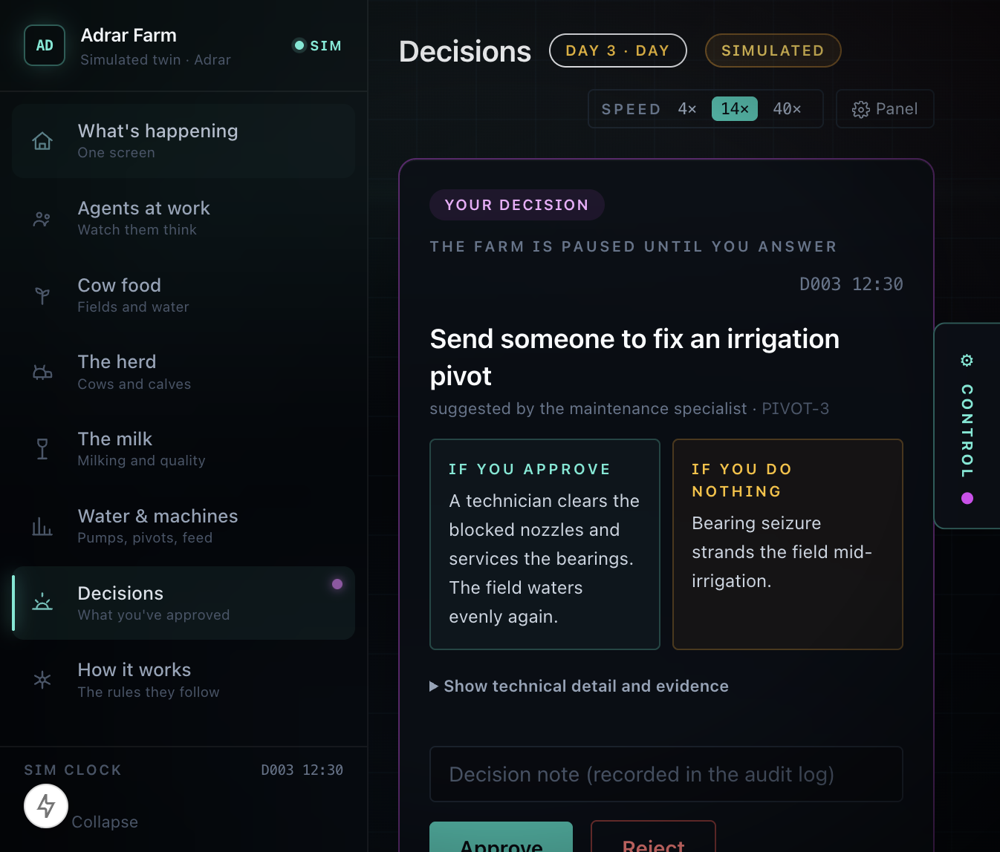

<p align="center">
  
</p>

# Aidustrial

**An agentic operations layer for large industrial farms: seven specialist AI Agents working 24/7, escalating consequential decisions to humans.**

Aidustrial is built around a **simulated** dairy complex in Adrar, Algerian
Sahara. The site is dimensioned from published Baladna Algeria figures where they
exist, and from explicitly labelled assumptions elsewhere. It is an independent
case study: Aidustrial has no relationship with Baladna and no access to their
telemetry. Baladna is the target: the goal is to integrate with them, and the
tool boundary is built for exactly that. Every reading on the dashboard is
generated by the digital twin and labelled as simulated.

`104 tests` · `Python 3.11+` · `LangGraph` · `FastAPI` · `Next.js 15`



*The farm pauses at a consequential proposal. The director sees the evidence,
blast radius and cost of inaction; nothing moves until they approve or reject.*

---

## What it is

Aidustrial is an agentic operations layer for a large industrial farm. Seven specialist agents, crop, agronomy, veterinary, calving,
milking, maintenance and logistics, read a live simulation through a tool layer,
share findings on a blackboard, and propose actions.

The promise is narrow and deliberate: **the agents do the watching and the
reasoning. The human keeps the authority.** Anything consequential stops at a
human gate with the evidence attached. The system is designed for the moment
before a site has complete telemetry, when coordination, not sensing, is the
expensive problem.

## The core feature: a gate that actually gates

This is the feature to judge. Every consequential proposal carries a
deterministic risk score, and the graph genuinely suspends until a person rules
on it:

- **Risk is never set by a model.** `score_risk()` is an inspectable function of
  severity, headcount, water moved, resource class and reversibility.
- **At or above the ceiling, or on the always-gate list, the graph interrupts.**
  LangGraph's `interrupt()` checkpoints the thread; there is no polling loop and
  no fake "waiting" state.
- **Approve applies the action. Reject changes nothing.** A rejection is recorded
  in the audit log and enters the same re-proposal cooldown as an execution, so
  the agent does not immediately ask the same question again.
- **The director sees why.** Rationale in plain language, blast radius, cost of
  inaction, risk and urgency as separate axes, reversibility, and the underlying
  evidence.

The regression test for the approve/reject contract is in
`agent/tests/test_aidustrial.py`; it snapshots the world before a rejection and
asserts byte-for-byte equality afterwards.

### Autonomy is tiered, not one number

`agent/src/aidustrial/twin/policy.py` decides which actions may run without a
person. It is configuration no model can reach:

| Tier | What it covers | Rule |
|---|---|---|
| **Runs alone** | lighting, dispatching a technician | no physical change, so any risk score is safe |
| **Bounded** | ventilation, misting | auto below **25**, stricter than the global ceiling |
| **Default** | everything else | auto below **40** |
| **Always a human** | water transfer, pivot restart, shed load, convoy reroute, quarantine | never auto, whatever the score |

A per-action ceiling may only ever be *stricter* than the global one, so a
future retune cannot widen autonomy past the gate. `agent/tests/test_policy.py`
asserts exactly that, plus that every always-gate action refuses to auto-execute
at risk 0, 10, 39 and 100.

### The audit trail survives the process

`agent/src/aidustrial/tools/ledger.py` writes every decision to SQLite, agent,
action, risk, verdict, and the reason it was gated, alongside events, work
orders and chat history. `GET /api/ledger` returns it, plus the policy table.

An action taken without a human is recorded too, marked `auto-policy` with the
ceiling it cleared. The claim being protected is simple: "auditable" should not
mean "auditable until the process exits".

### Ask a specialist

`agent/src/aidustrial/tools/agentchat.py` lets you put a question to any agent.
It answers from three places: its live readings, retrieved passages from the
eight-document corpus (`agent/knowledge/`), and its own events and decisions from
the ledger. Replies carry their citations.

Retrieval is SQLite FTS5, no embeddings, no vector service, no model download.
The corpus is dense with exact tokens (`PIVOT-3`, `mm/s`, `SCC`) that BM25
matches well, and a retrieval layer that cannot fail a container build is worth
more here than one that scores marginally better.

When no prose model is configured the same evidence is composed deterministically,
so the chat still works on a deployment without credentials.


## Run it locally

Prerequisites: Python 3.11+, [uv](https://docs.astral.sh/uv/), Node 20+, pnpm.

```bash
# 1. Agent core, LangGraph + FastAPI on :8781
cd agent
uv run uvicorn aidustrial.server.app:app --app-dir src --port 8781

# 2. Dashboard, Next.js on :3010
cd dashboard
pnpm install
pnpm exec next dev -p 3010
```

Open <http://localhost:3010>. The session opens at **Day 3, midday**: a pivot
fault has just happened, and the heatwave starts tomorrow.

No API keys are required. The deterministic rules and the human gate are the
product; the optional reasoning layer is described below.

### One container

The app also builds as a single image, with the dashboard served by FastAPI on
one origin. This is the recommended shape for a public demo:

```bash
docker build -t aidustrial .
docker run --rm -p 8080:8080 aidustrial
# open http://localhost:8080
```

Deployment steps for Render are in [`docs/DEPLOY.md`](docs/DEPLOY.md).

## Test it

```bash
cd agent
uv run pytest tests/ -q      # 104 tests, no network calls
```

The suite guards the properties that make the demo defensible rather than
decorative: the diurnal curve is a real 24-hour cycle; dry-arid heat is genuinely
*less* lethal than humid heat; radiant load is what makes Adrar hard anyway;
misting is constrained by hardware rather than water; agents do not re-propose
satisfied actions; and **a rejected proposal does not mutate the world**.

## Reasoning layer (optional)

Two model tracks run on top of the deterministic rules, and neither blocks a
tick:

| Track | Job | Latency | Failure mode |
|---|---|---|---|
| **Jev** (OpenCode Zen SystemOne) | decide: warranted? which action? how urgent? | ~0.9s measured on the development machine | falls back to rules |
| **Prose** (OpenCode Go, DeepSeek V4.1 Flash) | write the plain-language summary | slower, non-blocking | falls back to rules |

Both obey one invariant: **a model may escalate, never de-escalate past a rule.**
A model-originated action always faces a human because there is no sensor figure
to feed the risk scorer. Risk stays deterministic.

Without credentials, both tracks report as disabled and the dashboard says
**“Reasoning backend offline, deterministic rules and the human gate are
active.”** There are no hidden failures in the demo header.

Configuration and the full safety argument are in
[`AGENT.md`](AGENT.md) and [`docs/ARCHITECTURE.md`](docs/ARCHITECTURE.md).

## What is real, and what is simulated

**Real:** the Adrar site, its published parameters, the supplier list, the
non-renewable Albien aquifer constraint, the NRC heat-stress thresholds, and the
coordination problem. The public-data research is in
[`BALADNA_ALGERIA_DOSSIER.md`](BALADNA_ALGERIA_DOSSIER.md).

**Simulated:** every telemetry reading, the 51,548-animal herd state, crop
growth, silo inventory, tanker positions and the weather. The site has **no
operating herd and no live telemetry**: 45 wells are drilled, the first 30,000
animals are due from November 2026, and first milk powder is targeted for late
2027. The highest-value deployment window is *before* the first animal arrives, 
which is exactly the window this prototype is built for.

**Assumptions are labelled, not hidden.** Every constant is classified as
SOURCED, DERIVED, INDUSTRY, ASSUMPTION, DESIGN or MODELLED in
[`docs/DATA_PROVENANCE.md`](docs/DATA_PROVENANCE.md). That document also records
the unresolved 117,000 ha vs 219,000 ha conflict in the public sources.

**No relationship with Baladna, yet.** This is an independent case study, not a
partnership, pilot or endorsement. Baladna is the target we are building toward:
the tool boundary in `agent/src/aidustrial/tools/sensors.py` is the seam where
their real telemetry would connect, and integrating it with them is the
intended next step.

## Architecture

```
Layer 4  Next.js command center       decision gate, agents, trace, audit log
Layer 3  LangGraph orchestrator       sense -> triage -> wake -> consult -> gate
Layer 2  Seven specialist agents      crop, agronomy, vet, calving, milking,
                                      maintenance, logistics
Layer 1  Sensor gateway               tools/sensors.py -- the only boundary
         Memory + retrieval           SQLite: decision ledger + FTS5 corpus
Layer 0  Simulated Adrar twin         physics, herd, crops, logistics
```

The orchestrator routes and gates; it does no domain work. Specialists have
narrow mandates and bounded memory. Cross-consult is a real blackboard exchange,
not a fan-out. Details: [`docs/ARCHITECTURE.md`](docs/ARCHITECTURE.md).

## Tech stack

- **Backend:** Python 3.11+, LangGraph, FastAPI, WebSocket, Pydantic, pytest, ruff, uv
- **Frontend:** Next.js 15, React 19, TypeScript, Tailwind CSS, pnpm
- **AI:** OpenCode Zen / Jev for typed decisions; OpenCode Go / DeepSeek V4.1
  Flash for prose; OpenCode coding agents for implementation assistance
- **Data:** a deterministic digital twin seeded from published figures and
  domain literature, plus SQLite (stdlib `sqlite3`) for the decision ledger,
  work orders, chat history and the FTS5 retrieval index, one file, no server
  process, no vector store

## Who built what

**Solo submission (team of one): Mohammed Boukaba.**

- Product concept, domain research, data provenance, architecture, backend,
  frontend and tests: Mohammed Boukaba.
- A coding assistant was used for code implementation and test scaffolding.
  All design decisions, domain assumptions and verification are mine; I can
  walk through every module and every trade-off.
- No other team members. No earlier product code was reused; the repository
  history for the product begins with the October 2026 build.

Built for **Thirduni Cohort 1, October 2026**.

## Live demo and walkthrough

The repository includes a one-container build for deploying the app on a single
public URL ([`docs/DEPLOY.md`](docs/DEPLOY.md)). The three-minute screen-recorded
walkthrough, the primary demo for judging, is scripted in
[`docs/DEMO_SCRIPT.md`](docs/DEMO_SCRIPT.md).

The eight-item submission pack, including the 150-word description, team roles,
tech stack and what-happens-next, is in
[`docs/SUBMISSION.md`](docs/SUBMISSION.md).

## What happens next

In the next three months I would replace the simulated sensor gateway with one
real site's telemetry, pivot, collar, silo and tanker feeds, and run a
two-week shadow-mode pilot with an Algerian operator. I would publish the
risk-scoring and provenance method so decisions can be audited, add a
French/Arabic operator view, and keep the tool boundary open for other
integrators. The goal is not a fully autonomous farm. It is a system an
operations director trusts enough to use on a real shift.

## Known gaps

- The twin is a simulation, not a validated agronomic model.
- No operator interviews yet. The next step is validation with people who
  actually run large farms in Algeria.
- The reasoning layer depends on external models; the deterministic rules and
  the gate do not.
- The public demo has no authentication or rate limiting yet. It is a
  demonstration, not a production deployment.

## Docs

- [`docs/ARCHITECTURE.md`](docs/ARCHITECTURE.md), layer-by-layer design
- [`docs/DATA_PROVENANCE.md`](docs/DATA_PROVENANCE.md), sourced vs assumed
- [`docs/PITCH.md`](docs/PITCH.md), the longer project narrative
- [`docs/DEMO_SCRIPT.md`](docs/DEMO_SCRIPT.md), the three-minute walkthrough
- [`docs/SUBMISSION.md`](docs/SUBMISSION.md), the eight-item Thirduni pack
- [`docs/DEPLOY.md`](docs/DEPLOY.md), one-container deployment
- [`AGENT.md`](AGENT.md), working notes and the build history

## Licence and copyright

**Source-available, not open source.** The repository is public so that judges
and reviewers can read the code, verify authorship and run it to evaluate it.
That is the only purpose licensed. See [`LICENSE`](LICENSE) for the exact terms.

In short, you may read, clone, inspect and run this project for evaluation, and
quote short excerpts with attribution. You may **not** use it in a product or
service, modify or redistribute it, use it commercially, or train models on it
without written permission.

The name "Aidustrial", the logo, the documentation, the pitch deck and the demo
video are copyright © 2026 Mohammed Boukaba. **All rights reserved.**

Third-party libraries keep their own licences, see `agent/pyproject.toml`,
`agent/uv.lock` and `dashboard/package.json`.

Permissions and enquiries: [mohammed@pullrun.dev](mailto:mohammed@pullrun.dev)
